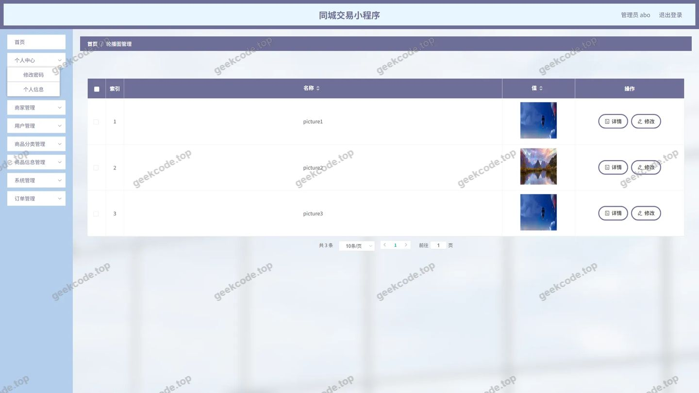
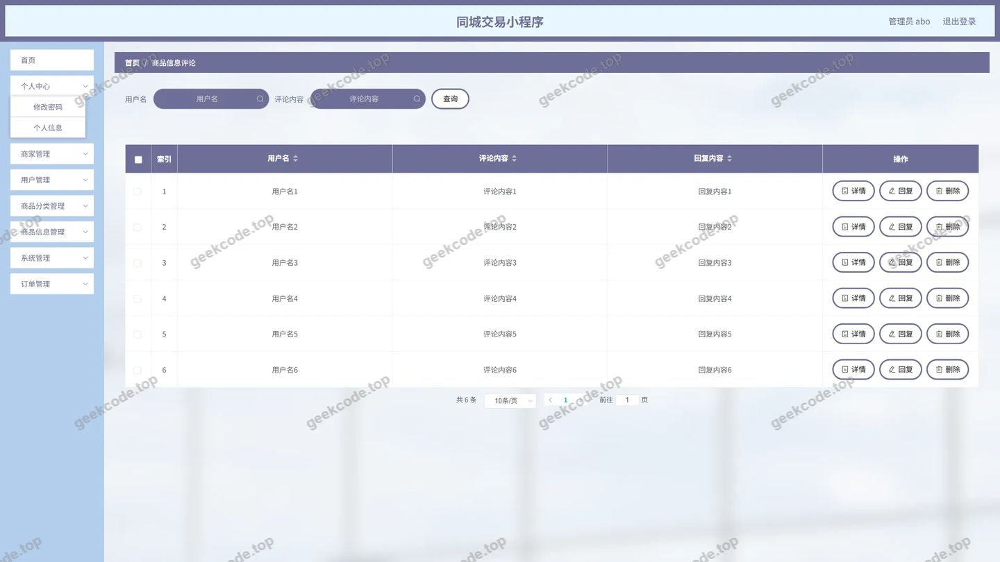
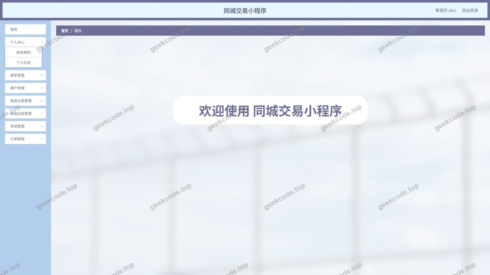
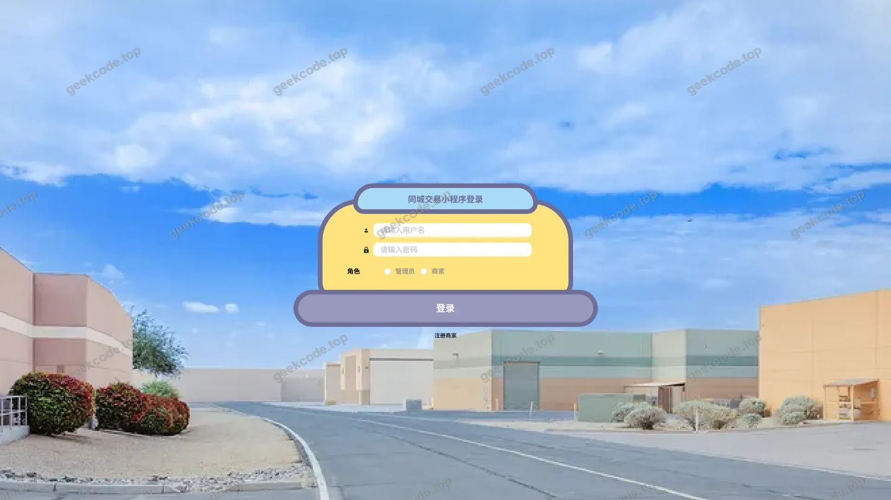
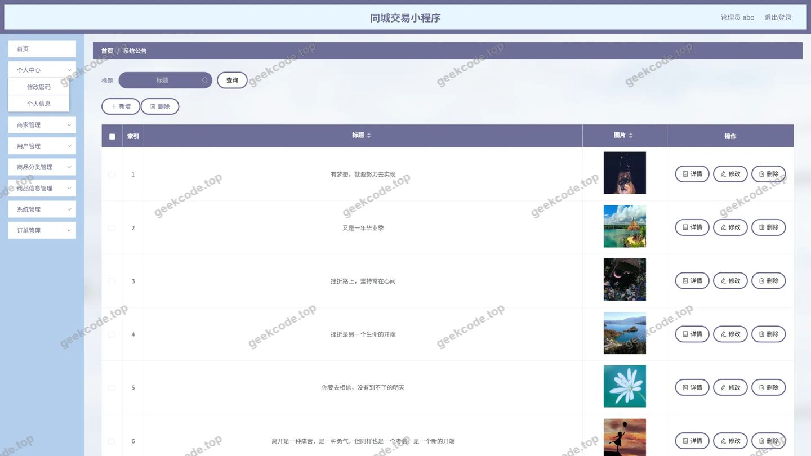
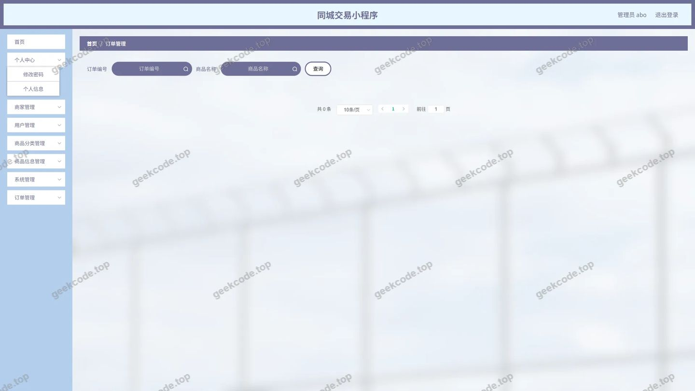
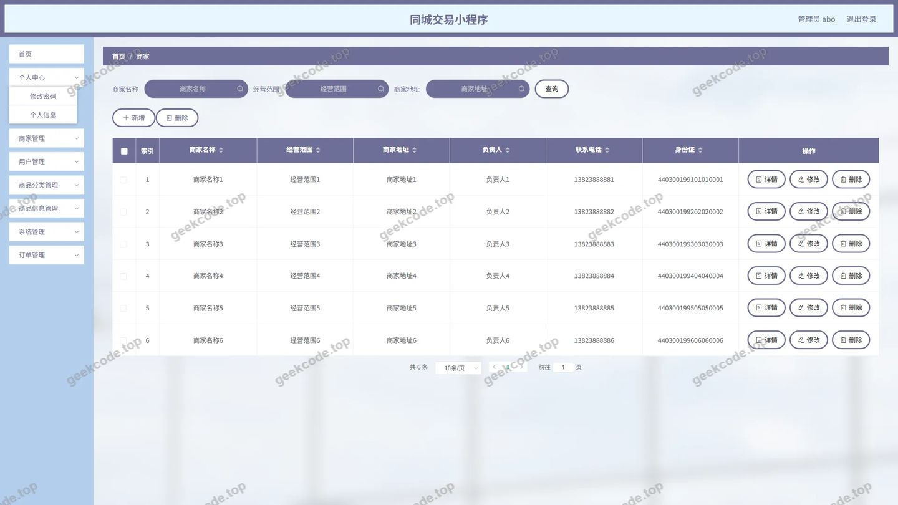
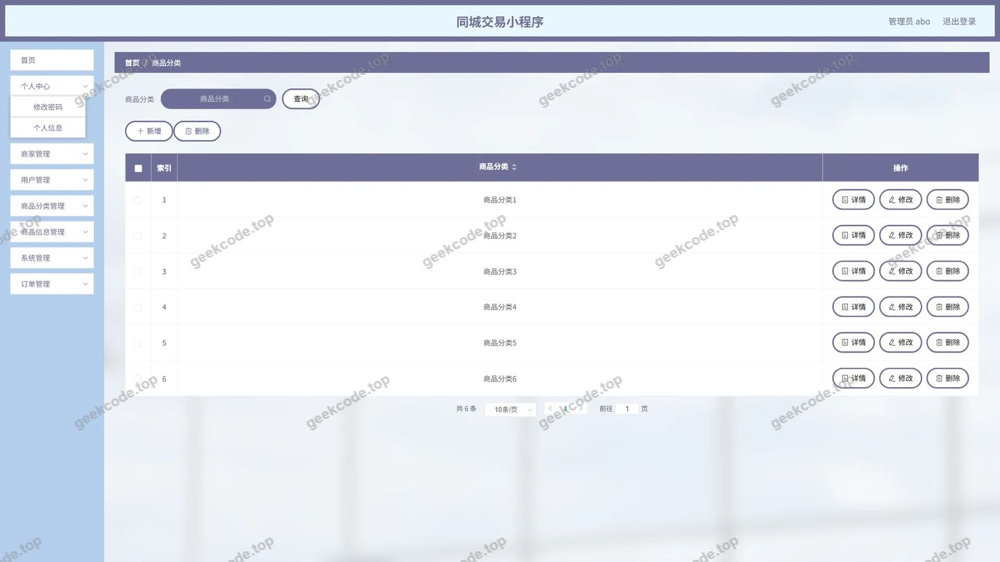
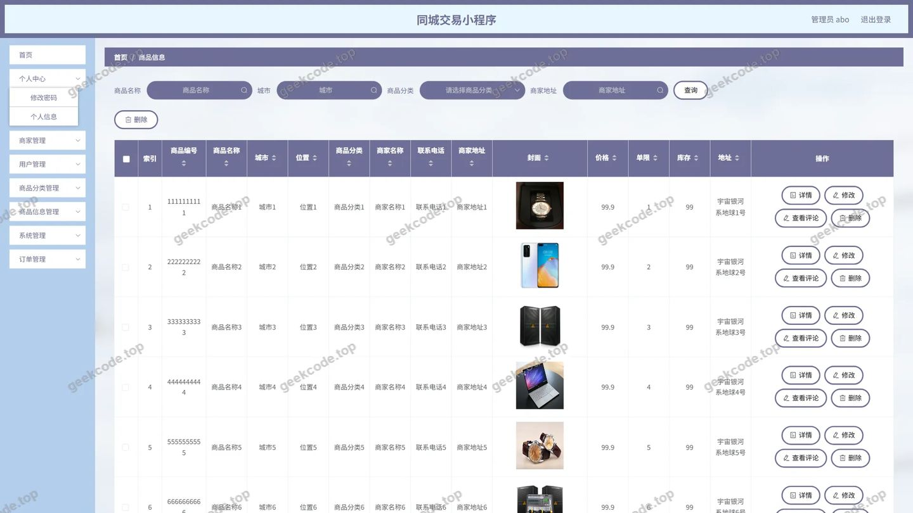
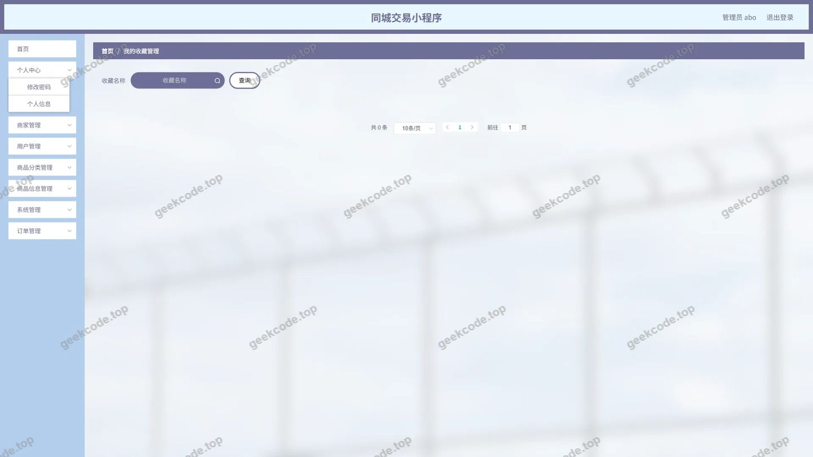

# 同城交易小程序

> 🎓 **计算机毕业设计 · 同城交易小程序**
>
> 本仓库只放**项目介绍 + 运行截图**（截图是站点带水印的原图，存在仓库 `images/` 里）。
>
> 👉 **完整可运行源码 / 数据库脚本 / 部署文档：[点我获取](https://geekcode.top/archives/%E5%90%8C%E5%9F%8E%E4%BA%A4%E6%98%93%E5%B0%8F%E7%A8%8B%E5%BA%8F?utm_source=github)**
>
> 💬 咨询微信：**ir9372**　|　🌐 更多项目：[极客代码 geekcode.top](https://geekcode.top/?utm_source=github)
>
> 📌 项目详情页：<https://geekcode.top/archives/%E5%90%8C%E5%9F%8E%E4%BA%A4%E6%98%93%E5%B0%8F%E7%A8%8B%E5%BA%8F?utm_source=github>

<table><td width="230" align="center"> <b>扫码加微信 ir9372</b></td><td valign="middle">📦 源码 = 项目介绍 + 全部运行截图 + 数据库 + 部署文档 👉 点上方任意截图，直接跳到 <b>极客代码 geekcode.top</b> 详情页</td></table>

---

<h1>同城交易小程序</h1>
<h2>项目概述</h2>

本项目名为“同城交易小程序”，旨在构建一个基于本地化服务的二手商品或闲置物品交易平台。系统核心目标是解决同城用户间信息不对称、交易效率低及信任缺失的问题，提供便捷的商品发布、浏览、下单及评价闭环服务。

适用人群主要为有闲置物品处理需求的个人卖家、寻求性价比商品的本地买家以及负责平台运营的管理员。技术架构采用前后端分离模式，后端基于 Java Spring Boot 框架，结合 MyBatis-Plus 进行持久层操作，使用 Druid 连接池优化数据库访问性能；前端通过 Vue.js 构建管理后台界面。由于项目类型标记为 <code>vue-integrated</code> 且无独立前台路由，推测其前台交互可能集成于微信小程序端或通过 API 接口供第三方调用，而本代码仓库主要聚焦于后台管理系统及核心业务逻辑的实现。

<h2>技术架构</h2>
<h3>前后端架构</h3>

本项目采用典型的 B/S（Browser/Server）架构与 RESTful API 设计风格。

<ul>
<li><strong>后端服务</strong>：基于 Spring Boot 生态体系，利用 <code>spring-webmvc</code> 处理 HTTP 请求，<code>spring-tx</code> 管理事务一致性，<code>spring-aop</code> 实现日志记录与权限校验等横切关注点。控制器层（Controller）清晰划分了业务边界，如 <code>OrdersController</code> 处理订单逻辑，<code>ShangpinxinxiController</code> 管理商品信息。</li>
<li><strong>数据持久层</strong>：选用 MyBatis-Plus 作为 ORM 框架，简化 CRUD 操作并支持动态 SQL 拼接。配合 Druid 数据库连接池，提供高效的数据库连接管理及监控功能。</li>
<li><strong>前端展示层</strong>：后台管理界面基于 Vue.js 框架构建，通过 Axios 等工具与后端接口通信，实现数据的异步加载与渲染。</li>
</ul>
<h3>数据库设计要点</h3>

根据 Controller 列表推断，核心数据实体包括：

<ol>
<li><strong>用户域</strong>：<code>Yonghu</code>（普通用户）、<code>Shangjia</code>（商家），存储账号密码、联系方式及角色标识。</li>
<li><strong>商品域</strong>：<code>Shangpinxinxi</code>（商品信息）、<code>Shangpinfenlei</code>（商品分类），包含标题、价格、图片、库存及所属分类 ID。</li>
<li><strong>交易域</strong>：<code>Orders</code>（订单表），关联用户、商品及状态字段；<code>Cart</code>（购物车），临时存储待结算商品。</li>
<li><strong>互动域</strong>：<code>Discussshangpinxinxi</code>（评论表），记录用户对商品的评价；<code>Storeup</code>（收藏表），记录用户感兴趣的商品。</li>
<li><strong>系统域</strong>：<code>Config</code>（配置表，用于轮播图等参数）、<code>News</code>（公告资讯）、<code>Address</code>（收货地址）。</li>
</ol>
<h3>核心技术选型理由</h3>
<ul>
<li><strong>Spring Boot</strong>：约定优于配置的开发理念，快速搭建企业级应用，内置 Tomcat 便于部署。</li>
<li><strong>MyBatis-Plus</strong>：在 MyBatis 基础上增强，避免大量 XML 配置，提高开发效率，适合中小规模 CRUD 密集型项目。</li>
<li><strong>Druid</strong>：阿里巴巴开源的高性能 JDBC 组件，具备强大的监控和扩展功能，能有效预防 SQL 注入并优化连接复用。</li>
</ul>
<h2>功能模块</h2>

根据后台路由 <code>/news</code>, <code>/yonghu</code>, <code>/shangpinfenlei</code>, <code>/discussshangpinxinxi</code>, <code>/shangpinxinxi</code>, <code>/orders/:status</code>, <code>/storeup</code>, <code>/config</code>, <code>/shangjia</code> 及截图功能列表，系统主要功能模块如下：

<h3>后台管理端</h3>

后台管理员可通过 Web 界面执行以下核心操作：

<ol>
<li><strong>系统登录与首页</strong></li>
</ol>
<ul>
<li>提供管理员身份认证入口。</li>
<li>首页展示关键数据统计概览（具体指标视图表定义而定）。</li>
</ul>
<ol start="2">
<li><strong>用户与商家管理</strong></li>
</ol>
<ul>
<li><strong>用户管理 (<code>/yonghu</code>)</strong>：查看、编辑、删除普通注册用户信息，重置密码或禁用异常账号。</li>
<li><strong>商家管理 (<code>/shangjia</code>)</strong>：审核入驻商家资质，管理商家基本信息及经营状态。</li>
</ul>
<ol start="3">
<li><strong>商品信息管理</strong></li>
</ol>
<ul>
<li><strong>商品分类 (<code>/shangpinfenlei</code>)</strong>：维护商品的层级结构，支持增删改查分类标签。</li>
<li><strong>商品信息 (<code>/shangpinxinxi</code>)</strong>：审核上架商品，修改商品详情、价格、库存及封面图，下架违规商品。</li>
<li><strong>轮播图/配置管理 (<code>/config</code>)</strong>：设置首页展示的轮播图片链接及排序权重，控制前端展示内容。</li>
</ul>
<ol start="4">
<li><strong>订单与交易管理</strong></li>
</ol>
<ul>
<li><strong>订单管理 (<code>/orders/:status</code>)</strong>：查看所有订单状态（待支付、已完成、已取消等），支持按状态筛选，处理退款申请或强制关闭异常订单。</li>
<li><strong>购物车 (<code>/cart</code>)</strong>：虽然路由中未直接列出，但存在 <code>CartController</code>，后台可监控用户加购行为数据。</li>
</ul>
<ol start="5">
<li><strong>内容与互动管理</strong></li>
</ol>
<ul>
<li><strong>系统公告 (<code>/news</code>)</strong>：发布平台通知、活动规则或安全提示，支持富文本编辑。</li>
<li><strong>商品评论 (<code>/discussshangpinxinxi</code>)</strong>：审核用户发布的评论内容，删除恶意刷屏或不实评价。</li>
<li><strong>我的收藏 (<code>/storeup</code>)</strong>：查看用户的收藏记录，分析热门商品趋势。</li>
</ul>
<ol start="6">
<li><strong>文件服务</strong></li>
</ol>
<ul>
<li>通过 <code>FileController</code> 提供图片上传接口，支撑商品主图、轮播图及用户头像的存储与管理。</li>
</ul>
<h3>前台用户端</h3>

根据上下文信息，该项目标记为 <code>vue-integrated</code> 且“是否有前台: 否”，同时“前台路由”为空。这表明当前代码库主要服务于后台管理系统。前台用户的具体交互界面（如小程序页面）未在本文档提供的源码结构中直接体现，通常此类项目的前台功能由独立的移动端工程或与后端对接的小程序原生页面实现。因此，<strong>根据现有信息无法确定具体的前台 UI 功能细节</strong>，仅能从 Controller 接口推断其具备以下潜在业务能力：

<ul>
<li>用户注册与登录。</li>
<li>浏览商品列表与分类筛选。</li>
<li>加入购物车与提交订单。</li>
<li>对已购买商品进行评论。</li>
<li>收藏心仪商品。</li>
</ul>
<h2>用户角色与权限</h2>

系统主要涉及两类角色，权限隔离明确：

<ol>
<li><strong>超级管理员 (Admin)</strong></li>
</ol>
<ul>
<li><strong>权限范围</strong>：拥有最高权限，可访问所有后台路由。</li>
<li><strong>核心职责</strong>：</li>
<li>全量数据管理：对用户、商家、商品、订单、评论、公告等进行增删改查。</li>
<li>系统配置：管理轮播图、网站基础参数。</li>
<li>审核监管：审核商家入驻资格，监控异常交易行为，清理违规内容。</li>
</ul>
<ol start="2">
<li><strong>普通用户/商家 (User/Merchant)</strong></li>
</ol>
<ul>
<li><strong>权限范围</strong>：通过 API 接口与系统交互，无后台管理界面访问权限（除非特定商家有独立端口，但当前路由仅显示 admin 视角）。</li>
<li><strong>核心职责</strong>：</li>
<li><strong>普通用户</strong>：浏览商品、下单购买、发表评价、收藏商品、管理个人收货地址。</li>
<li><strong>商家</strong>：发布自家商品、查看自己的订单、回复用户评论、管理店铺信息。</li>
<li><em>注：具体商家是否拥有独立后台入口需依据实际业务逻辑判断，当前文档仅描述了 Admin 可见的后台功能。</em></li>
</ul>
<h2>项目特色与创新点</h2>
<ol>
<li>
<strong>模块化设计与高内聚</strong>
   采用标准的 MVC 分层架构，Controller 层严格对应业务实体（如 <code>ShangjiaController</code> 专责商家逻辑），使得代码易于维护和扩展。各功能模块（如评论、收藏、订单）独立封装，降低了耦合度。

</li>
<li>
<strong>灵活的订单状态流转</strong>
   后台路由 <code>/orders/:status</code> 的设计暗示了系统支持精细化的订单状态查询与管理。这种设计允许管理员快速定位处于特定阶段（如“待发货”、“争议中”）的订单，提升了客服处理效率。

</li>
<li>
<strong>完善的互动反馈机制</strong>
   集成了 <code>Discussshangpinxinxi</code>（评论）和 <code>Storeup</code>（收藏）模块，不仅增强了平台的社交属性，也为算法推荐提供了基础数据支撑（尽管推荐算法本身未在代码中显式体现，但数据结构已预留）。

</li>
<li>
<strong>高效的数据访问层</strong>
   引入 MyBatis-Plus 与 Druid 组合，在保证开发速度的同时，兼顾了生产环境下的数据库性能与稳定性。Druid 的监控特性有助于开发者及时发现慢 SQL 和连接泄漏问题。

</li>
</ol>
<h2>部署环境</h2>

为确保项目正常运行，需准备以下软硬件环境：

<ol>
<li><strong>操作系统</strong></li>
</ol>
<ul>
<li>Windows 10/11, macOS, 或 Linux (CentOS 7+, Ubuntu 20.04+)。</li>
</ul>
<ol start="2">
<li><strong>开发运行环境</strong></li>
</ol>
<ul>
<li><strong>JDK</strong>：版本建议 JDK 8 或 JDK 11（取决于 Spring Boot 具体版本，通常兼容上述两者）。</li>
<li><strong>Maven</strong>：用于依赖管理和项目构建，版本 3.6+。</li>
<li><strong>MySQL</strong>：数据库服务器，建议版本 5.7 或 8.0。需创建对应的数据库实例并导入初始化 SQL 脚本。</li>
<li><strong>Node.js</strong>：若前端后台管理界面需要本地编译调试，建议安装 Node.js 14+ 及 npm/yarn。</li>
</ul>
<ol start="3">
<li><strong>中间件与服务</strong></li>
</ol>
<ul>
<li><strong>Redis</strong>：(可选) 若项目中使用了缓存注解或 Session 共享，需部署 Redis 服务。</li>
<li><strong>Nginx</strong>：(生产环境) 用于反向代理后端 API 和静态资源托管。</li>
</ul>
<ol start="4">
<li><strong>客户端工具</strong></li>
</ol>
<ul>
<li><strong>浏览器</strong>：Chrome, Edge 或 Firefox，用于访问后台管理系统。</li>
<li><strong>微信开发者工具</strong>：若前台确认为微信小程序，则需此工具进行真机调试与预览。</li>
</ul>
<h2>五、技术特性</h2>
<ul>
<li>前后端集成部署，前端资源打包至后端 static 目录</li>
<li>使用 MyBatis-Plus 简化数据访问层开发</li>
</ul>
<h2>六、功能模块截图</h2>
<h3>后台管理端</h3>
<h4>后台-系统配置</h4>

<h4>后台-商品信息评论</h4>

<h4>后台首页</h4>

<h4>后台-登录</h4>

<h4>后台-公告信息</h4>

<h4>后台-订单-状态</h4>

<h4>后台-商家</h4>

<h4>后台-商品分类</h4>

<h4>后台-商品信息</h4>

<h4>后台-收藏</h4>

---

## 获取完整源码

| 项目 | 说明 |
| --- | --- |
| 项目名 | 同城交易小程序 |
| 运行截图 | 本文 10 张（站点带水印原图，仓库 `images/` 目录） |
| 完整源码 | [https://geekcode.top/archives/%E5%90%8C%E5%9F%8E%E4%BA%A4%E6%98%93%E5%B0%8F%E7%A8%8B%E5%BA%8F?utm_source=github](https://geekcode.top/archives/%E5%90%8C%E5%9F%8E%E4%BA%A4%E6%98%93%E5%B0%8F%E7%A8%8B%E5%BA%8F?utm_source=github) |
| 咨询微信 | **ir9372**（备注：jingpin-yuanma） |
| 更多项目 | [极客代码 geekcode.top](https://geekcode.top/?utm_source=github) |

> 需要源码、部署、改配置、跑不起来等问题，加微信 ir9372 沟通，说明项目名即可。
